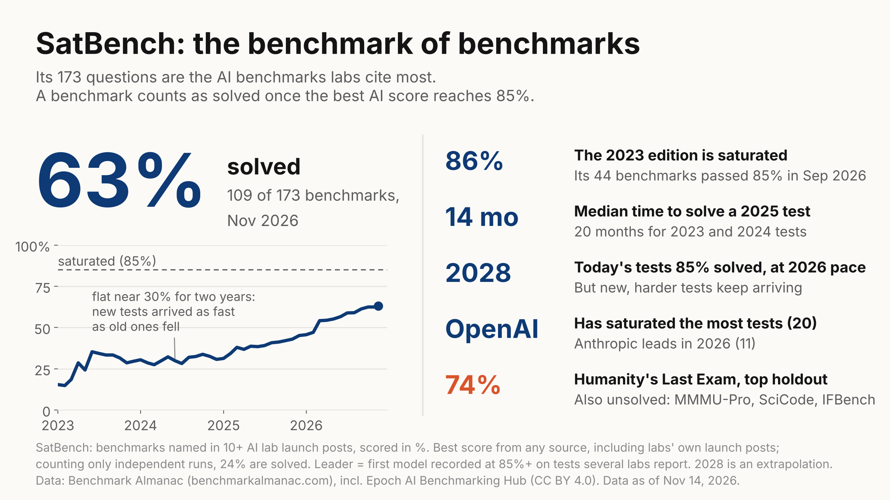
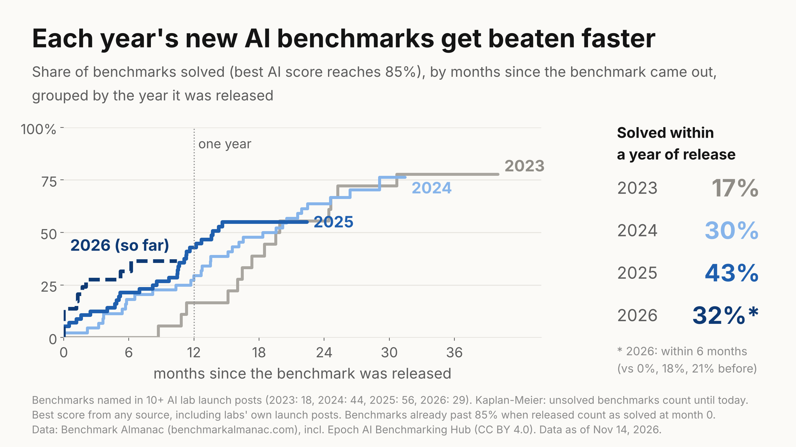
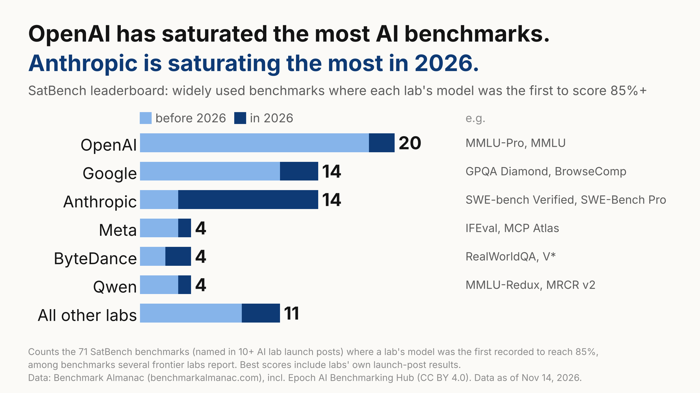
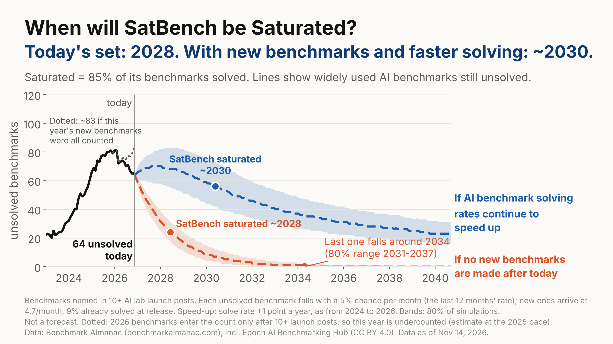
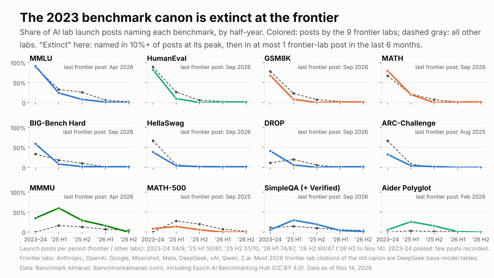
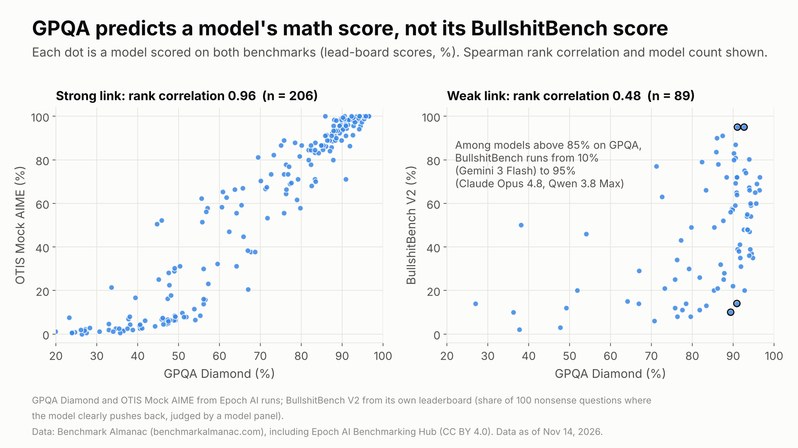

# SatBench: a benchmark of AI benchmarks

Two analyses of how AI benchmarks get used up, built on the [Benchmark Almanac](https://benchmarkalmanac.com)
([GitHub](https://github.com/brianlzhou/benchmark-almanac)) by Brian Zhou. Data as of Nov 14, 2026.

- **[SatBench](satbench/)** treats the 173 benchmarks AI labs cite most as the questions on one big exam.
  A question is solved once the best reported AI score reaches 85%. How much of the exam is solved, how fast,
  by whom, and when does it run out?
- **[Benchmark analysis](benchmark-analysis/)** looks at how benchmarks relate to each other (correlations and
  clusters) and at which ones labs have stopped reporting.

Every number comes from the almanac's own TypeScript data layer, so it matches the site. Each folder has a
`summary.md` with the full findings and caveats, and a `scripts/` folder that rebuilds every chart.

## SatBench



**SatBench stands at 63%: 109 of its 173 benchmarks are solved.** It sat near 30% from 2023 to early 2025,
while new benchmarks arrived about as fast as old ones fell, then climbed 20 points in the last 12 months. Its
own first edition, the 44 benchmarks that existed by the end of 2023, crossed 85% in September 2026, so the
benchmark of benchmarks has saturated once already.



**New benchmarks fall faster each year.** The share solved within a year of release went from 17% for 2023
releases to 30% for 2024 and 43% for 2025. The median time to 85% fell from about 20 months to about 14.



**OpenAI has been first past 85% on the most benchmarks (20), and Anthropic leads in 2026 (11).** A lab gets
credit when its model is the first recorded at 85% or above. Raw counts reward labs that report many niche
benchmarks no one else runs, so this leaderboard counts only the 71 benchmarks that several frontier labs
report.



**When will SatBench be saturated?** At the last 12 months' pace, about 5% of unsolved benchmarks fall each
month. Today's fixed set would be 85% solved around 2028. With new benchmarks arriving at the 2025 pace and
solving continuing to speed up, the live index gets there around 2030. We only run out of benchmarks if people
stop making them. This is an extrapolation, not a forecast.

More charts: [`satbench/index/`](satbench/index/) (the index, its robustness to other definitions, and
projections), [`satbench/items/`](satbench/items/) (holdouts and areas), and [`satbench/labs/`](satbench/labs/)
(who solved what, and how many already-saturated benchmarks labs still headline). Full write-up:
[`satbench/summary.md`](satbench/summary.md).

## Benchmark analysis: correlations, extinction, clusters



- **The 2023 canon is extinct at the frontier.** Every frontier-lab launch post from 2023-24 named at least one
  of MMLU, HumanEval, GSM8K, MATH, BBH, HellaSwag, DROP or MGSM. In 2026, 2 of 134 did. Benchmarks are
  saturated first and dropped second: 28 of the 32 extinct families were past 85% when labs last named them.
- **24 of the 30 benchmarks named most often in launch posts are past 85%**, and 12 are past 95%.



- **Nearly every benchmark correlates with every other** (median rank correlation 0.67), because most of the
  variation is one general-capability factor. After controlling for Epoch's Capabilities Index, the median pair
  falls to 0.06.
- **A few benchmarks measure something else**, such as hallucination rate, games, GAIA and BullshitBench.
- **Clusters are soft.** After the general factor, the main split is building and agentic tasks against exams.
  The almanac's subject areas barely match how benchmarks actually group, and contest coding behaves like math.

Charts: [`correlations/`](benchmark-analysis/correlations/), [`saturation/`](benchmark-analysis/saturation/),
[`clusters/`](benchmark-analysis/clusters/). Full write-up: [`benchmark-analysis/summary.md`](benchmark-analysis/summary.md).

## What the data can't support

- **Many "solved" benchmarks rest on labs' own claims.** Best scores mix harnesses, tool use, best-of-n and
  launch-post self-reports. Counting only independent runs, SatBench is at 24%, not 63%. Three in four first
  crossings past 85% come from the lab's own launch post, and only 10 of those 75 were later matched by an
  independent run.
- **Before 2025 the data is thin.** There are only 43 launch posts from 2023-24, against about 230 a year since,
  so treat early numbers as rough.
- **The score grid is sparse.** Most models are not scored on most benchmarks (the cluster analysis works with a
  matrix that is 40% filled), and boards use different harnesses.
- **Recent benchmarks are undercounted.** A benchmark enters SatBench only after 10 launch-post mentions, which
  takes months, so 2026 releases, mostly unsolved, are not yet all counted.
- The projections assume the remaining benchmarks are no harder than the ones already solved.

Each `summary.md` lists more caveats, and SatBench's lists possible data errors in the almanac worth checking.

## Reproducing

```sh
pip install -r requirements.txt
satbench/scripts/run.sh
benchmark-analysis/scripts/run.sh
```

Each `run.sh` clones the almanac at the commit its charts used, dumps the site's data layer with Node 22.18+,
and redraws the charts in place. Rerun at those commits, the charts match the published images. See the
`scripts/README.md` in each folder for details.

## Data and licenses

**This repository contains no almanac data.** The almanac's code is MIT-licensed, but its data has no single
license: each source keeps its own terms, and some are non-commercial (the SWE-bench boards are CC BY-NC 4.0 and
MathArena's datasets CC BY-NC-SA 4.0). The scripts download the data from the almanac instead of
redistributing it. See the [almanac's License section](https://github.com/brianlzhou/benchmark-almanac#license)
before reusing any derived data.

**Credits:** data from the [Benchmark Almanac](https://benchmarkalmanac.com) by Brian Zhou, including the
[Epoch AI Benchmarking Hub](https://epoch.ai/benchmarks) (CC BY 4.0), official leaderboards (each board's
makers), and AI labs' launch posts. Artificial Analysis scores are not included, because of its terms.

The analysis, charts and code in this repository are released under [CC0 1.0](LICENSE).
